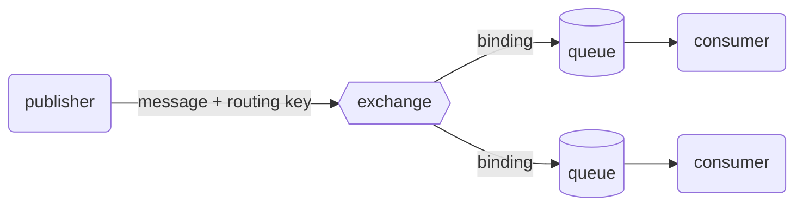

# Messaging

Imagine ten cameras, three programs that process their images and two that show results. If every program connects directly to the others, each one must know all the others' addresses, and must be running whenever another one sends. A **message broker** removes that: it is a server in the middle, like a post office. Programs only connect to it; they **publish** messages to it and **subscribe** to the messages they want, and the broker delivers each message to whoever asked. A program can come and go without the others noticing. This guide runs the broker [RabbitMQ](https://www.rabbitmq.com) in a container and talks to it from Python, on a fresh Ubuntu install. It assumes you have done [Python](python.md) and [Containers](containers.md).

!!! info "To learn more"

    - [Publish–subscribe pattern](https://en.wikipedia.org/wiki/Publish%E2%80%93subscribe_pattern);
    - [AMQP 0-9-1 concepts](https://www.rabbitmq.com/tutorials/amqp-concepts) and [RabbitMQ's tutorials](https://www.rabbitmq.com/tutorials), in Python with pika, which this guide follows;
    - [Consumer prefetch](https://www.rabbitmq.com/docs/consumer-prefetch), [acknowledgements](https://www.rabbitmq.com/docs/confirms) and [queue length limits](https://www.rabbitmq.com/docs/maxlength);
    - [pika](https://pika.readthedocs.io/en/stable/), the Python client.

## Starting a broker

```shell
docker run -d --rm --name rabbitmq -p 5672:5672 -p 15672:15672 rabbitmq:4.3.6-management
```

This runs RabbitMQ in the background, with two ports published (see [Containers](containers.md#running-a-server)): 5672 for **AMQP**, the protocol programs use to talk to it, and 15672 for its [management](https://www.rabbitmq.com/docs/management) web page. Wait a few seconds for it to start, then open <http://localhost:15672>, user and password `guest`: the page shows what is inside the broker, and will be useful to watch the examples below. `docker stop rabbitmq` stops it and, with `--rm`, deletes it with everything in it.

Then a Python project with **pika**, the package that speaks AMQP:

```shell
mkdir messaging && cd messaging
uv init --bare --python 3.12
uv add pika
```

## How the broker routes messages

A message is just some bytes, plus a label. Inside RabbitMQ, it goes through two kinds of things on its way from a publisher to a consumer:



- A **queue** is a line of messages waiting to be taken, first in, first out. A **consumer** is a program that takes messages from a queue. Several consumers of one queue share its messages: each message goes to one of them.
- An **exchange** is the sorting room. A publisher never writes to a queue directly: it sends each message to an exchange, with a **routing key**, a label such as `lab.temperature`. The exchange copies the message into every queue that is **bound** to it with a matching key.
- A message that matches no binding is thrown away: the broker keeps nothing for topics nobody listens to.

## A work queue

The simplest case: a list of tasks shared by several workers, like customers at a counter served by several clerks. Save as `worker.py`:

```python
import time

import pika

connection = pika.BlockingConnection(pika.ConnectionParameters("localhost"))
channel = connection.channel()
channel.queue_declare(queue="tasks", durable=True)
channel.basic_qos(prefetch_count=1)            # one unacknowledged message at a time


def handle(channel, method, properties, body):
    print("working on", body.decode())
    time.sleep(1)                              # the work
    channel.basic_ack(delivery_tag=method.delivery_tag)


channel.basic_consume(queue="tasks", on_message_callback=handle)
channel.start_consuming()
```

and as `send.py`:

```python
import pika

connection = pika.BlockingConnection(pika.ConnectionParameters("localhost"))
channel = connection.channel()
channel.queue_declare(queue="tasks", durable=True)

for n in range(4):
    channel.basic_publish(exchange="", routing_key="tasks", body=f"task {n}")
    print("sent task", n)
connection.close()
```

Open two terminals and run `uv run worker.py` in each: they wait. In a third, run `uv run send.py`. The tasks are split between the workers: one prints `working on task 0` and `task 3`, the other `task 1` and `task 2`. Stop the workers with ++ctrl+c++.

What the code does:

- `BlockingConnection(...)` opens a connection to the broker on `localhost`, port 5672 by default; `connection.channel()` opens a **channel** inside it, through which everything else is done.
- `queue_declare(queue="tasks", durable=True)` creates the queue `tasks`, or does nothing if it exists, so whichever program starts first creates it. `durable=True` makes the queue survive a broker restart; RabbitMQ 4 requires it for a named queue, and older tutorials without it fail with ``Feature `transient_nonexcl_queues` is deprecated`` (see [deprecated features](https://www.rabbitmq.com/docs/deprecated-features)).
- `basic_publish(exchange="", routing_key="tasks", body=...)` sends a message. `exchange=""` is the **default exchange**, which delivers a message to the queue whose name is its routing key.
- `handle` is a **callback**: a function you don't call yourself, but give to pika, `on_message_callback=handle`, which calls it for each message. `body` is the message's bytes, and `.decode()` turns them into text.
- `start_consuming()` waits forever, calling `handle` as messages arrive.

## Acknowledgements and prefetch

`basic_ack` is the worker saying "done" to the broker, an **acknowledgement**. Until a message is acknowledged, the broker keeps a copy, and if the worker crashes it gives the message to another one: no task is lost. `basic_qos(prefetch_count=1)` tells the broker to send a worker its next message only after the previous one is acknowledged, so a busy worker doesn't collect a pile of tasks that a free one could take.

The other way is `auto_ack=True`: the broker forgets a message as soon as it sends it. It's faster, and a crashing consumer loses what it had received. That suits data that is only useful while fresh, such as sensor readings or video frames, where the next one replaces the lost one anyway.

## Publish and subscribe by topic

Now many publishers and many subscribers, each subscriber choosing what it wants. A **topic exchange** routes by pattern. Routing keys are words separated by dots, such as `kitchen.temperature`; in a binding, `*` matches exactly one word and `#` any number of words. Save as `publish.py`, a fake network of sensors:

```python
import json
import random
import time

import pika

connection = pika.BlockingConnection(pika.ConnectionParameters("localhost"))
channel = connection.channel()
channel.exchange_declare(exchange="sensors", exchange_type="topic")

for _ in range(5):
    for room in ("kitchen", "lab"):
        reading = {"celsius": round(random.uniform(20.0, 25.0), 1), "time": time.time()}
        channel.basic_publish(exchange="sensors", routing_key=f"{room}.temperature",
                              body=json.dumps(reading))
    channel.basic_publish(exchange="sensors", routing_key="lab.humidity",
                          body=json.dumps({"percent": 55, "time": time.time()}))
    time.sleep(1)
connection.close()
```

and as `subscribe.py`, which listens to the pattern given after its name:

```python
import json
import sys

import pika

pattern = sys.argv[1]                          # such as "*.temperature" or "lab.#"
connection = pika.BlockingConnection(pika.ConnectionParameters("localhost"))
channel = connection.channel()
channel.exchange_declare(exchange="sensors", exchange_type="topic")
queue = channel.queue_declare(queue="", exclusive=True).method.queue
channel.queue_bind(exchange="sensors", queue=queue, routing_key=pattern)


def show(channel, method, properties, body):
    print(method.routing_key, json.loads(body))


channel.basic_consume(queue=queue, on_message_callback=show, auto_ack=True)
channel.start_consuming()
```

Run `uv run subscribe.py "*.temperature"` in one terminal and `uv run subscribe.py "lab.#"` in another, then `uv run publish.py` in a third. The first one prints the temperatures of both rooms; the second one everything from the lab, temperature and humidity:

```
*.temperature                                 lab.#
kitchen.temperature {'celsius': 24.9, ...}    lab.temperature {'celsius': 20.9, ...}
lab.temperature {'celsius': 20.9, ...}        lab.humidity {'percent': 55, ...}
```

- The lab's temperature reaches both subscribers: each one has a queue of its own, and the exchange copies the message into every matching queue.
- **JSON** is a way to write data as text, with `json.dumps` turning a dictionary into text and `json.loads` back. It is one choice for a message's bytes; see [What goes in a message](#what-goes-in-a-message).
- `queue_declare(queue="", exclusive=True)` asks the broker for a new queue with a generated name, private to this subscriber and deleted when it disconnects. `queue_bind` binds it to the exchange with the pattern.
- `sys.argv[1]` is the first word typed after the program's name.
- The publisher knows nothing about the subscribers: start a third one, with any pattern, and it gets its messages without changing anything else.

## Requests and replies

Sometimes a program needs an answer: "what is 7 squared?". Through the broker, the request carries two extra things: `reply_to`, the queue where the answer should go, and `correlation_id`, an id to recognize the answer among others. Save as `rpc_server.py`:

```python
import pika

connection = pika.BlockingConnection(pika.ConnectionParameters("localhost"))
channel = connection.channel()
channel.queue_declare(queue="square", durable=True)


def answer(channel, method, properties, body):
    result = int(body) ** 2
    channel.basic_publish(exchange="", routing_key=properties.reply_to, body=str(result),
                          properties=pika.BasicProperties(correlation_id=properties.correlation_id))
    channel.basic_ack(delivery_tag=method.delivery_tag)


channel.basic_consume(queue="square", on_message_callback=answer)
channel.start_consuming()
```

and as `rpc_client.py`:

```python
import uuid

import pika

connection = pika.BlockingConnection(pika.ConnectionParameters("localhost"))
channel = connection.channel()
replies = channel.queue_declare(queue="", exclusive=True).method.queue

request_id = str(uuid.uuid4())
channel.basic_publish(exchange="", routing_key="square", body="7",
                      properties=pika.BasicProperties(reply_to=replies, correlation_id=request_id))

for method, properties, body in channel.consume(replies, auto_ack=True, inactivity_timeout=5):
    if body is None:
        print("no reply")
        break
    if properties.correlation_id == request_id:
        print("7 squared is", body.decode())
        break
connection.close()
```

With `uv run rpc_server.py` running in one terminal, `uv run rpc_client.py` in another prints `7 squared is 49`. This is called **RPC**, a remote procedure call: calling a function that runs in another program.

- The client makes a private queue for its replies and sends its request to the `square` queue, with `reply_to` set to that queue.
- `uuid.uuid4()` generates a random id, practically never repeated, for `correlation_id`.
- The server answers to `properties.reply_to`, copying the `correlation_id`.
- The client waits on its queue, up to 5 seconds (`inactivity_timeout=5`; `body` is `None` when time runs out), for the reply with its id.
- Several servers on the `square` queue share the requests, like the workers above.

## Keeping only the newest

If the consumers are slower than the publishers, a queue grows without end. For data where only the latest value matters, limit the queue, and let the broker drop the oldest message when it's full:

```python
import pika

connection = pika.BlockingConnection(pika.ConnectionParameters("localhost"))
channel = connection.channel()
channel.queue_declare(queue="latest", durable=True,
                      arguments={"x-max-length": 1, "x-overflow": "drop-head"})

for n in range(5):
    channel.basic_publish(exchange="", routing_key="latest", body=f"frame {n}")

method, properties, body = channel.basic_get(queue="latest", auto_ack=True)
print(body.decode())                           # frame 4: the older ones were dropped
connection.close()
```

`x-max-length` caps the queue at 1 message; `drop-head` drops from its head, the oldest. `basic_get` takes one message, without waiting. A queue's arguments are fixed when it's created: declaring it again with others fails with `PRECONDITION_FAILED`. Delete it first, from the management page or with `docker exec rabbitmq rabbitmqctl delete_queue latest`.

## What goes in a message

The broker carries bytes and never looks inside them, so the publisher and the consumer must agree on what they mean. JSON, used above, is readable and needs nothing installed. [Protocol Buffers](protocol-buffers.md), the next guide, are smaller and faster, with a schema both sides share, which suits images and frequent messages.

## When something doesn't arrive

Two commands show what the broker sees, run inside its container with `docker exec`:

```shell
docker exec rabbitmq rabbitmqctl list_queues name messages consumers
docker exec rabbitmq rabbitmqctl list_bindings
```

| Symptom | Likely cause |
|---|---|
| the subscriber gets nothing | it started after the message was published, or its pattern doesn't match the routing key |
| messages pile up in a queue | no consumer, or consumers slower than the publishers |
| `ConnectionRefusedError` | the broker isn't running, or isn't on that address and port (see [Networking](networking.md)) |
| `PRECONDITION_FAILED` on declare | the queue or exchange exists with other settings |
| one worker is swamped while another sits idle | no `prefetch_count`: the broker deals the messages out in turn, however long each takes |

## What you learned

- A broker sits between programs: publishers send to exchanges, exchanges copy into queues, consumers take from queues.
- A work queue shares tasks between workers; acknowledgements and prefetch make sure none is lost or hoarded.
- A topic exchange delivers by pattern, `*` for one word and `#` for any number, to any number of subscribers.
- Requests carry `reply_to` and `correlation_id` to get their answer back.
- A length limit keeps only the newest messages.
