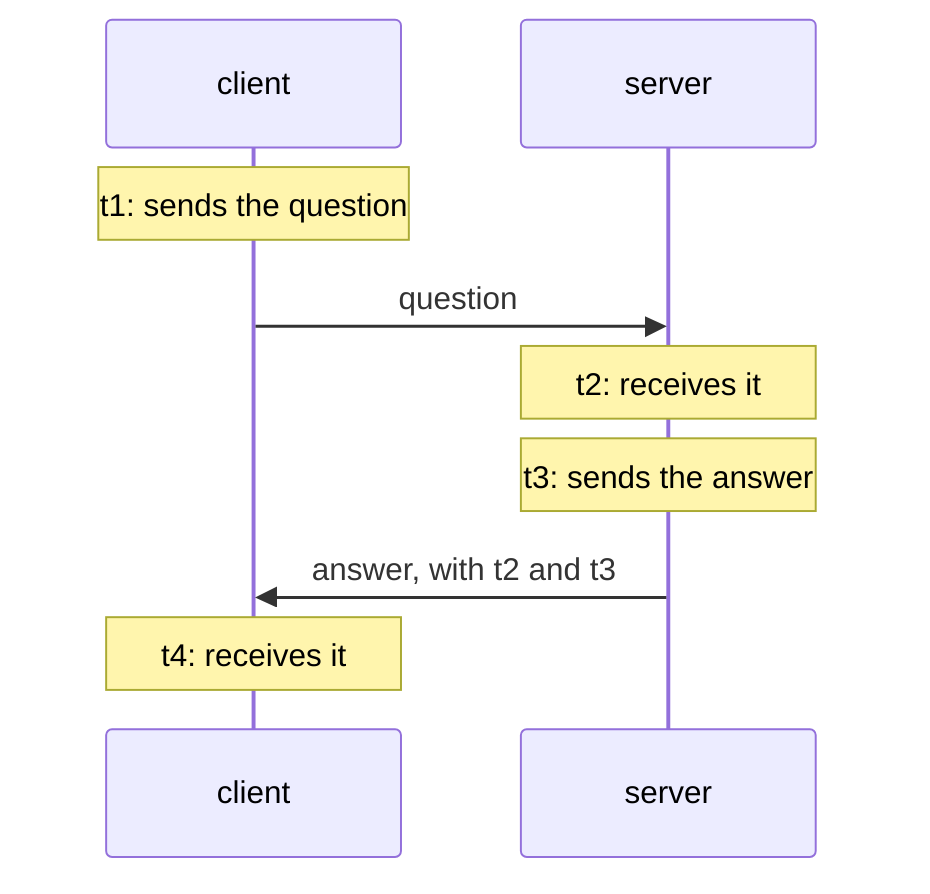

# Time synchronization

When data comes from several computers, such as images from cameras on different computers, it is combined by **when** each piece was taken: two images of the same instant show the same scene, and only those can be combined. Each computer writes that instant, a **timestamp**, with its own clock. If the clocks disagree, images of the same instant look different in time, and images of different instants look the same. This guide explains why clocks disagree, how to keep them together on a fresh Ubuntu install, and how programs should take and match timestamps. It assumes you have done [The terminal](terminal.md), [Python](python.md) and [Networking](networking.md).

!!! info "To learn more"

    - [Clock drift](https://en.wikipedia.org/wiki/Clock_drift), [Network Time Protocol](https://en.wikipedia.org/wiki/Network_Time_Protocol) and [Precision Time Protocol](https://en.wikipedia.org/wiki/Precision_Time_Protocol);
    - [chrony's documentation](https://chrony-project.org/documentation.html) and [linuxptp](https://linuxptp.nwtime.org/);
    - [Python's `time` module](https://docs.python.org/3/library/time.html).

## Clocks drift

A computer counts time with a small quartz crystal that vibrates at a known frequency, like a watch. No crystal is exact: each is off by a few **parts per million**, ppm, and changes with temperature. 20 ppm, a typical value, means 20 microseconds lost or gained every second: 1.7 seconds a day. Two computers set to the same time drift apart by seconds within days, and by milliseconds within minutes.

Is a millisecond a lot? A camera at 30 frames per second takes an image every 33 ms. A robot moving at 1 m/s travels 1 cm in 10 ms. To match images of the same instant, or to know where the robot was in each one, the clocks must agree to well under a millisecond.

**Synchronization** keeps correcting each clock against a reference. Two numbers describe a clock against the reference: its **offset**, how far ahead or behind it is now, and its **drift**, how fast that offset changes.

## NTP

The **Network Time Protocol**, NTP, sets a clock by asking a server that knows the time. The trick is the network: the answer takes time to arrive, so NTP measures how long the question and answer took, and accounts for it. Ubuntu does this by itself, with public servers on the internet. Check it:

```shell
timedatectl
```

```
               Local time: Thu 2026-11-12 19:48:52 -03
           Universal time: Thu 2026-11-12 22:48:52 UTC
System clock synchronized: yes
              NTP service: active
```

`synchronized: yes` means it works. Ubuntu uses one of two programs for it: `systemd-timesyncd`, a simple one, or `chrony`, a complete one that also measures how good the clock is and can serve the time to other computers. Install chrony for anything beyond a desktop:

```shell
sudo apt install -y chrony         # replaces systemd-timesyncd
chronyc tracking                   # how far this clock is, and how fast it drifts
chronyc sources -v                 # the servers it follows, explained
```

```
Reference ID    : C8A00008 (a.ntp.br)
System time     : 0.000023794 seconds slow of NTP time
Frequency       : 15.775 ppm slow
```

`System time` is the offset now: 24 microseconds slow. `Frequency` is the drift chrony found, 15.8 ppm, and corrects all the time. Over the internet, NTP keeps clocks within about a millisecond; on a local network, with one server for all, within tens of microseconds.

### Measuring an offset yourself

How can a client tell its offset when the network delay is unknown? With four timestamps:



`t1` and `t4` are read on the client's clock, `t2` and `t3` on the server's. The time spent on the network is the whole round trip minus the time the server took: `(t4 - t1) - (t3 - t2)`. If the trip takes as long each way, the server's clock read `t2` when the client's would have read halfway, and the offset is `((t2 - t1) + (t3 - t4)) / 2`. Save as `offset.py` and run `python3 offset.py`:

```python
import socket
import struct
import sys
import time

NTP_TO_UNIX = 2208988800                       # seconds from 1900 (NTP) to 1970 (Unix)


def ntp_time(data: bytes, offset: int) -> float:
    seconds, fraction = struct.unpack("!II", data[offset:offset + 8])
    return seconds - NTP_TO_UNIX + fraction / 2**32


server = sys.argv[1] if len(sys.argv) > 1 else "pool.ntp.org"
address = socket.gethostbyname(server)        # resolve first: DNS would count as delay
request = b"\x23" + 47 * b"\0"                 # version 4, client mode
with socket.socket(socket.AF_INET, socket.SOCK_DGRAM) as sock:
    sock.settimeout(2.0)
    t1 = time.time()                           # we send
    sock.sendto(request, (address, 123))
    data, _ = sock.recvfrom(48)
    t4 = time.time()                           # we receive
t2, t3 = ntp_time(data, 32), ntp_time(data, 40)   # the server receives, the server sends

delay = (t4 - t1) - (t3 - t2)
offset = ((t2 - t1) + (t3 - t4)) / 2
print(f"round trip {delay * 1e3:.1f} ms, our clock is {-offset * 1e3:+.2f} ms off the server's")
```

```
round trip 14.6 ms, our clock is -0.16 ms off the server's
```

How it works:

- NTP runs over UDP (see [Networking](networking.md#tcp-and-udp)), on port 123. `socket.socket(socket.AF_INET, socket.SOCK_DGRAM)` makes a UDP **socket**, a program's end of a network connection.
- The question is 48 bytes, all zero but the first, which says "NTP version 4, I am a client". The answer is 48 bytes too, with the server's times at bytes 32 and 40.
- `struct.unpack("!II", ...)` reads two whole numbers from the bytes: NTP's seconds, counted from 1900, and a fraction of a second. `ntp_time` turns them into seconds since 1970, like `time.time()`.
- `socket.gethostbyname` finds the server's address before `t1`: otherwise the name lookup (see [Networking](networking.md#names)) would count as network delay, and spoil the result.

Run it a few times: the result changes by a few milliseconds. A single exchange can't tell a slow way out from a slow way back, so its error can be up to half the round trip. chrony does the same exchange many times, keeps the fastest ones, and follows the drift between them, which is how it reaches microseconds.

### One server for a local network

Computers that must agree with each other should follow the same server, on their own network: then they agree with each other far better than with the internet. On the computer that serves the time, allow the local network to ask it, in a file `/etc/chrony/conf.d/server.conf` (edit it with `sudo nano`, since it belongs to the system):

```
allow 10.20.0.0/16
```

On each of the others, follow that computer, here at `10.20.0.1`, in `/etc/chrony/sources.d/local.sources`:

```
server 10.20.0.1 iburst
```

Then `sudo systemctl restart chrony` on each, to apply. `chronyc sources` on a client shows the server, with a `*` in front once it follows it.

## PTP

The **Precision Time Protocol**, PTP, goes below a microsecond. NTP's timestamps are taken by programs, after the operating system handles each packet, which adds uneven delays; PTP takes them in the network card itself, the moment a packet passes. That needs network cards, and switches, that support it. Check a card:

```shell
ethtool -T enp3s0
#   PTP Hardware Clock: none     no support; a number, such as 0, means it has one
```

On Linux, the `linuxptp` package provides it: `ptp4l` synchronizes the card's clock with the network, and `phc2sys` the computer's clock with the card's. Many industrial cameras support PTP themselves, which synchronizes the cameras' own clocks with no computer in between.

## Timestamps in programs

**Take the time where the data is captured.** A camera image is best stamped by the camera, at the moment of exposure; the next best is the computer that reads it, as soon as it arrives. The time a message reaches another program adds the network and waiting in queues, which vary from one message to the next: never use the arrival time as if it were the capture time.

**Use the right clock.** Python has several:

```python
import time

start_wall, start_mono = time.time(), time.monotonic()
time.sleep(0.5)
print(f"wall clock: {time.time() - start_wall:.3f} s, monotonic: {time.monotonic() - start_mono:.3f} s")
print(time.time(), time.time_ns())             # seconds since 1970-01-01 UTC, and nanoseconds
```

- `time.time()` is the **wall clock**: the date and time, as seconds since the start of 1970, UTC. It means the same on every synchronized computer, so it is the one to put in a message.
- But the synchronization corrects the wall clock, and can even move it back. To measure how long something takes, use `time.monotonic()`, which only ever moves forward, or `time.perf_counter()`, the most precise. Their values mean nothing on their own, only the difference between two readings.

**Keep UTC.** UTC is the same everywhere, with no time zones or daylight saving. Store and send times as seconds since 1970 in UTC, and turn them into local time only to show them to people.

## Matching data by time

Data from several sources arrives in any order and after any delay. Group it by its timestamps instead: readings close enough, within a **tolerance**, are the same instant.

```python
readings = [                                   # (source, capture time in seconds)
    ("camera 0", 10.000), ("camera 1", 10.004), ("camera 2", 10.031),
    ("camera 0", 10.100), ("camera 2", 10.102), ("camera 1", 10.135),
]
tolerance = 0.010                              # readings this close are the same instant

groups = []
for source, stamp in sorted(readings, key=lambda reading: reading[1]):
    if groups and stamp - groups[-1][0][1] <= tolerance:
        groups[-1].append((source, stamp))
    else:
        groups.append([(source, stamp)])
for group in groups:
    print([source for source, _ in group], "at", group[0][1])
```

```
['camera 0', 'camera 1'] at 10.0
['camera 2'] at 10.031
['camera 0', 'camera 2'] at 10.1
['camera 1'] at 10.135
```

The readings are sorted by time (`key=lambda reading: reading[1]` sorts by the second item, the time). Each one joins the current group if it is within the tolerance of the group's first reading, or starts a new group. Camera 2's first image and camera 1's second are 27 and 35 ms away from the others: they are different instants.

Choosing the tolerance: larger than how much the clocks disagree, plus the jitter of the timestamps, or images of the same instant end up apart; smaller than half the time between images, or two instants merge. At 30 images per second, 33 ms apart, a few milliseconds is right, which is again why the clocks must agree to well under a millisecond.

## When times don't match

| Symptom | Likely cause |
|---|---|
| data from one computer always a little early or late | its clock isn't synchronized: `timedatectl`, `chronyc tracking` |
| offsets of tens of milliseconds between computers | each follows a different internet server: give them one local server |
| a duration comes out negative, or huge | measured with `time.time()` across a clock correction: use `time.monotonic()` |
| times off by whole hours | a local time where UTC was expected |
| samples that should match never group | the tolerance is smaller than the clocks' disagreement, or the arrival time was used |

## What you learned

- Every clock drifts, by parts per million; synchronization corrects its offset and drift.
- NTP measures the network delay with four timestamps; chrony reaches microseconds on a local network with one shared server; PTP goes further with hardware support.
- Stamp data where it's captured, with the wall clock, in UTC; measure durations with the monotonic clock.
- Match data from several sources by timestamp, within a tolerance.
